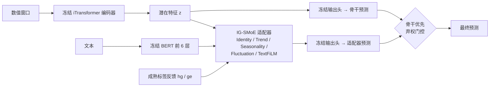

# On-Adapter

**在线多模态适配器在统一九域 benchmark 上的诊断、改进与确认实验**

On-Adapter 在冻结的 iTransformer 骨干上挂一个融合数值与文本信息的轻量适配器，并在测试时利用延迟到达的标签持续反馈。本仓库包含：

- 一个所有方法共用的九域多模态时间序列 benchmark；
- 对原始 On-Adapter 的问题诊断；
- 改进后的方法 **On-Adapter-CV**；
- 方法冻结后在 3 个训练 seed 上的确认实验。

> 所有结果均为**探索性**结果，详见 [限制](#8-限制)。完整的实验设计、统计定义与数据来源见 [docs/EXPERIMENT_DESIGN_AND_RESULTS.md](docs/EXPERIMENT_DESIGN_AND_RESULTS.md)。

---

## 1. 要点

| | |
|---|---|
| **尾部风险名次第一** | CVaR₉₀ 平均名次 3.380，在 7 个方法中最好（静态骨干为 3.843） |
| **优于全部其他对照** | 主统计优于全部在线方法（ADAPT-Z、DSOF、Proceed）和多模态方法（GPT4MTS、MM-TSFlib） |
| **大幅改进原方法** | 主统计从 1.0936 降到 1.0005；尾部优于骨干的任务从 17/36 增加到 22/36 |
| **与静态骨干持平，未超越** | 主统计比 iTransformer 高 0.05%，剩余差距集中在 Health_US |

---

## 2. 结果

**确认实验设置：**
- 训练 seed 为 2025 / 2026 / 2027；
- 方法与计划在产生任何确认结果之前冻结，计划见 [PLAN.json](reports/v1conf_20261009/PLAN.json)；
- 对照方法未做任何调参。

| 方法 | 类型 | 主统计 S ↓ | CVaR₉₀ 平均名次 ↓ | 平均 MAE | 平均 MSE | 尾部优于骨干的任务 |
|---|---|---:|---:|---:|---:|---:|
| iTransformer | 静态 | **1.000000** | 3.843 | **1.0628** | **11.978** | — |
| **On-Adapter-CV（本文）** | 在线 · 多模态 | 1.000495 | **3.380** | 1.0716 | 12.100 | **22/36** |
| On-Adapter-TA（消融：去掉 CVaR 损失） | 在线 · 多模态 | 1.000108 | 3.481 | 1.0655 | 12.008 | 21/36 |
| MM-TSFlib | 静态 · 多模态 | 1.014709 | 4.009 | 1.0690 | 12.089 | 16/36 |
| GPT4MTS | 静态 · 多模态 | 1.035984 | 4.000 | 1.0879 | 12.205 | 16/36 |
| ADAPT-Z | 在线 | 1.049515 | 3.731 | 1.1421 | 13.390 | 18/36 |
| DSOF | 在线 | 1.050956 | 3.972 | 1.2860 | 13.904 | 15/36 |
| On-Adapter（原始） | 在线 · 多模态 | 1.093644 | — | 1.0974 | 12.210 | 17/36 |
| Proceed | 在线 | 1.110804 | 5.065 | 1.1752 | 13.486 | 11/36 |

**表格说明：**
- **主统计 S：** 先算每格 CVaR₉₀ 与同格 iTransformer 的比值，再对 3 个 seed 取平均，最后对 36 个域/H 任务等权取几何平均。越低越好，iTransformer 恒为 1。
- **平均名次：** 在 108 个"域/H/seed"格内对 7 个方法排名后取平均。On-Adapter-TA 的名次在它自己的 7 方法表中计算。
- **分 seed 的 S：**
  - On-Adapter-CV：1.00082 / 1.00118 / 0.99938；
  - On-Adapter-TA：1.00192 / 0.99972 / 0.99857。

**逐域 CVaR₉₀ 相对骨干**（低于 1 表示优于 iTransformer；先对 3 个 seed 取平均，再在 4 个 H 上取几何平均）：

| 域 | On-Adapter-CV | On-Adapter-TA | 适配器被采用的比例（CV / TA） |
|---|---:|---:|---:|
| Environment | **0.990** | 1.002 | 0.60 / 0.40 |
| Energy | 1.002 | 1.000 | 0.43 / 0.45 |
| Health_US | 1.029 | 1.018 | 0.46 / 0.39 |
| Traffic | **0.983** | **0.985** | 0.81 / 0.72 |
| SocialGood | 1.006 | 1.000 | 0.12 / 0.47 |
| Security | **0.999** | 1.000 | 0.23 / 0.35 |
| Economy | **0.998** | **0.999** | 0.54 / 0.52 |
| Climate | 1.003 | **0.999** | 0.25 / 0.34 |
| Agriculture | **0.995** | **0.998** | 0.58 / 0.56 |

数值保留 3 位小数，逐任务结果见 [results.json](reports/v1conf_20261009/results.json) 的 `per_task`。

**消融结论：** CVaR 尾部损失改善了平均名次（3.48 → 3.38），并改善了 Environment、Agriculture 和 Traffic；但它加重了 Health_US 的尾部（1.018 → 1.029），因此主统计没有下降。两个版本都与骨干持平，都没有严格胜出。

---

## 3. 方法：On-Adapter-CV



**原方法的诊断**（证据见 `reports/` 下的诊断目录与 [docs 第 5 节](docs/EXPERIMENT_DESIGN_AND_RESULTS.md#5-原始-on-adapter-的结构与问题诊断)）：

| 问题 | 证据 |
|---|---|
| 在线参数更新在非月频域失控 | 关闭更新后，Energy 的 CVaR 比值从约 1.96 回到约 1.00 |
| VICReg 对齐项主导训练 | 训练目标为 4–17，验证 MSE 只有 0.03–3 |
| 训练预算不足 | 只训练 3 轮；放宽到 15 轮后，部分格子在第 15 轮仍在改善 |
| 训练损失与评价指标不一致 | 训练用逐元素 MSE，评价看逐原点 MAE 的尾部 |

**相对原方法的 5 项改动**（数据、骨干、专家结构、文本编码与反馈计算都不变）：

1. **关闭 VICReg 文本—数值对齐项**，对齐系数设为 0。
2. **训练轮数上限从 3 改为 15。** 早停 patience 仍为 3，仍按验证 MSE 选检查点。
3. **CVaR₉₀ 变分尾部损失：** L = MSE + 0.5 · [τ + mean(max(eᵢ − τ, 0)) / 0.1]。
   - eᵢ 为逐原点的已观测 MAE，所用变量、mask 和尺度与评分一致；
   - τ 为各批 90% 分位数的跨批次指数移动平均。
4. **骨干优先的弃权门控：**
   - 默认输出骨干预测；
   - 当适配器在已成熟原点上的折扣平均 MAE（γ = 0.9）低于骨干时，切换到适配器；
   - 至少需要 4 个成熟原点，并带滞回。
5. **关闭在线参数更新。** 反馈 hg/ge 与门控决策仍然逐原点进行，只是不再更新参数。

**信息边界：** 反馈与门控只使用满足 `old_origin + H ≤ current_origin` 的成熟标签，预测时从不读取当前或未来的目标与 mask。

**代码位置：**
- 方法版本包：[method_comparison_v1conf_20261009/](method_comparison_v1conf_20261009/)，相对上游的差异记录在 `FORK.json`；
- 门控：[scripts/seed2_round5_ta.py](scripts/seed2_round5_ta.py) 中的 `abstain`；
- 在线复现框架：[scripts/onadapter_harness_20261008.py](scripts/onadapter_harness_20261008.py)。

---

## 4. Benchmark 与评测协议

### 4.1 数据

- **来源：** Time-MMD 的 9 个域，包括数值序列和文本 `fact` 字段。
- **文本：** 使用 V1 最小修复版，只屏蔽经来源核实"晚于描述时点"的条目，共 413 处，占 1.34%；数值列逐字节不变。
- **文本编码：** 独立编码，每段文本单独前向，batch 恒为 1。

| 域 | 频率 | 回看窗口 L | 预测步长 H |
|---|---|---:|---|
| Environment | 日 | 96 | 48 / 96 / 192 / 336 |
| Energy、Health_US | 周 | 24 | 12 / 24 / 36 / 48 |
| Traffic、SocialGood、Security、Economy、Climate、Agriculture | 月 | 8 | 6 / 8 / 10 / 12 |

共 9 个域 × 4 个 H = 36 个任务。

### 4.2 协议（所有方法一致）

- 训练 / 验证 / 测试按时间顺序 60% / 20% / 20%；标准化只用训练段拟合；
- 输入缺失时先前向填充，再用训练均值；目标缺失时 mask，不插补；
- 所有方法的预测原点网格和 mask 相同；
- 检查点按验证 MSE 选择，测试段不调参。

### 4.3 评分

实现见 [benchmark_textrepair_v1/score.py](benchmark_textrepair_v1/score.py) 的 `cell_metrics`：

1. 每个预测原点取全部已观测目标元素的 MAE，在训练集标准化尺度下计算；
2. CVaR₉₀ 取最坏 10% 概率质量内的平均损失，边界原点按分数权重计入，并与变分定义交叉核对，误差小于 1e-12；
3. 由 CVaR₉₀ 汇总出主统计 S 和平均名次，定义见第 2 节。

### 4.4 对照方法

| 方法 | 代码来源（固定 commit） | 结果来源 |
|---|---|---|
| iTransformer | thuml/Time-Series-Library `4e938a17` | 复用历史同协议格，经哈希与数值等价验证 |
| ADAPT-Z | xiannanhuang/ADAPT-Z `f5b70e11` | 同上 |
| DSOF | yyalau/iclr2025_dsof `11cebd98` | 同上 |
| Proceed | SJTU-DMTai/OnlineTSF `0a864619` | 同上 |
| GPT4MTS | Flora-jia-jfr/GPT4MTS `c85e74b2` | 在 V1 上重新训练 |
| MM-TSFlib | AdityaLab/MM-TSFlib `e789ce78` | 在 V1 上重新训练 |
| On-Adapter（原始） | 原论文补充包实现 | 在 V1 上重新训练 |

**结果文件：**
- V1 主表：3 seed × 36 任务 × 7 方法 = 756 格，见 [results.json](reports/benchmark_textrepair_v1_20261008/results.json) 和 [results.csv](reports/benchmark_textrepair_v1_20261008/results.csv)；
- 协议说明：[PROTOCOL.md](reports/benchmark_textrepair_v1_20261008/PROTOCOL.md)。

---

## 5. 复现

### 5.1 环境

Python 3.9，PyTorch 2.8（CUDA 12.9）。全部命令都在仓库根目录执行。

```bash
pip install -r requirements.txt
bash scripts/fetch_external.sh      # 按 SOURCE.json 下载 6 个对照方法的代码（固定 commit），并用 MANIFEST.sha256 逐文件校验
python scripts/fetch_weights.py     # 下载 bert-base-uncased 和 gpt2 的权重（固定 revision）
```

> **路径需要替换：** 配置文件中的 `runs_root`、`cache_root`、`control_file`、`report_root`，以及 `scripts/v1conf_dispatch.sh` 里的 `B=`，都是原实验机器上的路径（`E:/FedNoise/...`、`C:/Users/...`），使用前需改成本机路径。

### 5.2 V1 benchmark 主表

```bash
python -m benchmark_textrepair_v1.runner run      # 训练 3 个读文本方法 × 3 seed，可断点续跑
python -m benchmark_textrepair_v1.finalize audit
python -m benchmark_textrepair_v1.score
```

不读文本的 4 个对照共 432 格，复用历史同协议格。这些格的哈希由 [legacy_numeric_reuse_manifest.json](benchmark_textrepair_v1/legacy_numeric_reuse_manifest.json) 固定，兼容性另有两份文件验证：[reuse_verification.json](reports/benchmark_textrepair_v1_20261008/reuse_verification.json)、[numeric_reuse_equivalence.json](reports/benchmark_textrepair_v1_20261008/numeric_reuse_equivalence.json)。它们的原始运行目录不在仓库中。

### 5.3 On-Adapter-CV 确认实验

```bash
# 1) 训练（On-Adapter-TA 换成 ..._ta_20261009.json）
python -m benchmark_v1conf.runner run --config configs/method_comparison_v1conf_cv_20261009.json
# 2) 逐原点在线测试轨迹
python scripts/v1conf_20261009.py --list cv | while read t d h s; do
  python scripts/v1conf_20261009.py --traj $t $d $h $s < /dev/null
done
# 3) 计分
python scripts/v1conf_20261009.py --score
```

`scripts/v1conf_dispatch.sh` 把这三步串起来：训练在 GPU 上串行，测试轨迹在 CPU 上并行。

---

## 6. 仓库结构

```
├── method_comparison_v1conf_20261009/          最终方法（On-Adapter-CV / TA）
├── method_comparison_textrepair_v1_20261008/   V1 benchmark 包：7 个方法的实现与桥接
├── benchmark_text_repair_all9_v1/              V1 文本修复：数据构建代码与 348 条判定规则
├── benchmark_textrepair_v1/                    V1 主实验驱动、审计与冻结评分
├── benchmark_v1conf/                           三 seed 确认实验驱动
├── original-paper-replay/uniform-l36-source/   原始 On-Adapter 源码（方法代码依赖）
├── scripts/                                    在线复现框架、门控、计分、调度、下载脚本
├── configs/                                    V1 主实验与确认实验配置
├── reports/                                    V1 数据、主表、确认结果、冻结计划与哈希、开发记录
├── docs/                                       完整实验设计与结果文档
├── external/  weights/                         第三方代码与权重的固定来源（只含 SOURCE.json 和校验清单）
└── requirements.txt
```

---

## 7. 开发过程

方法在单个训练 seed（seed 2）上迭代了 12 轮，规则如下：
- 每轮先冻结计划（`PLAN.json` 及其 sha256），只在验证集上选型；
- 测试只计算一次；
- 从第 8 轮起，只有稳健验证分数 ≤ 0.985 时才动用测试。

| 轮 | 改动 | 测试 S | 结论 |
|---|---|---:|---|
| 1–2 | 在线残差校准（按步 / 按季节相位） | 1.015 / 1.013 | 验证—测试反转 |
| 3 | 关闭 VICReg，训练轮数改为 15 | 1.006 | 适配器开始学到修正 |
| 4 | 门控 + 校准专家 | 1.009 | 校准成分失效 |
| 5 | 骨干优先弃权门控 | 1.003 | seed 2 上主统计最好 |
| 6 | 小步长在线更新 | 1.003 | 与第 5 轮持平 |
| 7–11 | 离线季节偏差、集成、去辅助项、L2-SP 锚定 | — | 被验证集否决，未动用测试 |
| 12 | CVaR 尾部损失 | 1.004 | 平均名次 7 方法第一，成为最终方法 |

记录位置：
- 汇总：[SUMMARY_rounds1-8.md](reports/seed2_goal_20261009/SUMMARY_rounds1-8.md)、[GOAL_STATUS.md](reports/seed2_goal_20261009/GOAL_STATUS.md)；
- 各轮细节：`reports/seed2_goal_20261009/round*/`。

仓库只保留最终流程的代码，不包含中间版本包。

---

## 8. 限制

- **测试时间段相同：** seed 2025–2027 与开发用的 seed 2 处在同一测试时间段。确认实验检验的是方法对训练随机性的稳健性，不是在全新数据上的泛化。
- **调参投入不对称：** On-Adapter 经过 12 轮开发，对照方法都用原始设置。
- **在线成分有限：** 最终方法关闭了在线参数更新，在线部分只保留反馈和门控。
- **骨干数值差异：** On 内部的骨干在 CPU 上计算，与主表 iTransformer（GPU）之间的最大绝对差为 0.0101。
- **文本因果性：** V1 只修复了已确认的时间错配，不能宣称全部文本无泄露。
- **结论范围：** 0.05% 的主统计差距在统计上与持平无法区分。本仓库不声称显著、普遍最优或 SOTA。

---

## 9. 旧版本

旧版仓库内容（iAdapter 原论文代码与数据补充包）保留在标签 [`legacy-iadapter-supplement`](https://github.com/lmh20050609-beep/on-adapter/tree/legacy-iadapter-supplement) 中：

```bash
git checkout legacy-iadapter-supplement
```
