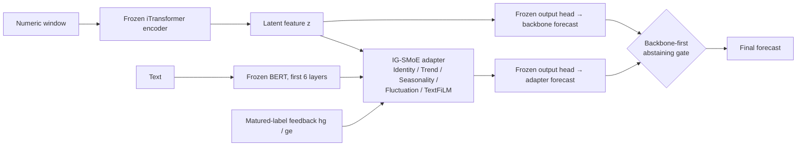

# On-Adapter

**Diagnosing, improving and confirming an online multimodal adapter on a unified nine-domain benchmark**

On-Adapter attaches a lightweight adapter to a frozen iTransformer backbone. The adapter fuses numeric and text information and keeps receiving feedback at test time from labels that arrive with a delay. This repository contains:

- a nine-domain multimodal time-series benchmark shared by all methods;
- a diagnosis of the initial version of On-Adapter (**Original On-Adapter**);
- our improved method, **On-Adapter**;
- a confirmation experiment on 3 training seeds, run after the method was frozen.
- the final comparison against nine baselines (including SOLID, ADCSD and COSA on the same frozen backbone), ablations, and the LaTeX tables of the paper.

> **Naming.** On-Adapter here means our improved version. The initial version is called **Original On-Adapter**, and the ablation without the CVaR tail loss is **On-Adapter w/o CVaR loss**. In code and result files (`results.json`, `PLAN.json`, `confirm.py`) the same three appear as `On-Adapter-CV` (tag `cv`), `On-Adapter` and `On-Adapter-TA` (tag `ta`).

> All results are **exploratory**; see [Limitations](#8-limitations). The full experimental design, statistical definitions and data sources are in [docs/EXPERIMENT_DESIGN_AND_RESULTS.md](docs/EXPERIMENT_DESIGN_AND_RESULTS.md).

---

## 1. Highlights

Ten methods on 9 domains × 4 horizons × 3 training seeds (108 test streams). SOLID, ADCSD and COSA adapt the same frozen iTransformer checkpoints that form the backbone row; the other methods are trained under the same data, split and scoring protocol.

| | |
|---|---|
| **Best mean rank of ten methods** | Mean CVaR₉₀ rank 4.77 (ADCSD 4.94, SOLID 5.25, backbone 5.76); in the top five of 66.7% of test streams, the most of any method |
| **Only method better than the backbone in both average and tail error** | Task-ratio geometric mean 0.9993 on MAE and 0.9992 on CVaR₈₀; all eight other methods are above 1 on both |
| **Bounded worst case** | No task more than 5.8% worse than the backbone; COSA reaches 2.64×, ADAPT-Z 1.84× |
| **Highest gain-to-harm ratio** | 0.87 (ADCSD 0.62, SOLID 0.41, COSA and Proceed 0.07) |
| **Large gain over the original method** | CVaR₉₀ statistic from 1.0936 to 1.0005; worst task from 2.53× to 1.06× |
| **Ties the backbone on CVaR₉₀** | 1.0005 vs 1.0000; the difference to ADCSD (1.0008) is not significant (60 wins / 48 losses, sign test p = 0.29) |

---

## 2. Results

### 2.1 Main comparison (seeds 2025 / 2026 / 2027)

| Method | S (CVaR₉₀) ↓ | S (CVaR₈₀) ↓ | S (MAE) ↓ | Mean rank ↓ | Top-5 share ↑ | Tasks >2% worse ↓ | Worst task ↓ | Gain/Harm ↑ |
|---|---:|---:|---:|---:|---:|---:|---:|---:|
| **On-Adapter (ours)** | 1.0005 | 0.9992 | 0.9993 | 4.77 | 66.7% | 3 | 1.058 | 0.87 |
| ADCSD | 1.0008 | 1.0016 | 1.0003 | 4.94 | 63.9% | 1 | 1.046 | 0.62 |
| SOLID | 1.0014 | 1.0023 | 1.0028 | 5.25 | 50.9% | 1 | 1.083 | 0.41 |
| iTransformer (backbone) | 1.0000 | 1.0000 | 1.0000 | 5.76 | 46.3% | — | — | — |
| MM-TSFlib | 1.0147 | 1.0100 | 1.0024 | 5.63 | 42.6% | 11 | 1.182 | 0.21 |
| GPT4MTS | 1.0360 | 1.0389 | 1.0249 | 5.59 | 47.2% | 11 | 1.639 | 0.19 |
| ADAPT-Z | 1.0495 | 1.0398 | 1.0239 | 5.12 | 52.8% | 12 | 1.838 | 0.18 |
| DSOF | 1.0510 | 1.0847 | 1.2058 | 5.50 | 44.4% | 21 | 1.579 | 0.46 |
| COSA | 1.0910 | 1.0764 | 1.0688 | 5.39 | 55.6% | 10 | 2.639 | 0.07 |
| Proceed | 1.1108 | 1.1016 | 1.0631 | 7.05 | 29.6% | 16 | 1.704 | 0.07 |
| Original On-Adapter (reference, not ranked) | 1.0936 | | | | | 11 | 2.533 | |

**Definitions:**
- **S:** for each of the 36 domain/H tasks, the ratio of a method's metric to the backbone's, averaged over the 3 seeds; then the geometric mean over tasks. Below 1 means better than the backbone.
- **CVaRα:** the mean of the worst (1 − α) share of per-origin MAEs within a test stream (`cell_metrics` in [benchmark/score.py](benchmark/score.py)).
- **Mean rank / Top-5 share:** the ten methods are ranked by CVaR₉₀ within each of the 108 streams.
- **Tasks >2% worse / Worst task:** count of tasks with CVaR₉₀ ratio above 1.02, and the largest task ratio.
- **Gain/Harm:** Σ max(0, 1 − r) / Σ max(0, r − 1) over the 36 task CVaR₉₀ ratios r.

**Not in our favour, reported for completeness:**
- on CVaR₉₀, On-Adapter ties the backbone rather than beating it;
- on CVaR₉₅, ADCSD (0.9999) is better than On-Adapter (1.0036);
- per dataset (MSE/MAE and CVaR₉₀), several baselines win individual columns, for example DSOF on Climate and SocialGood.

All of these are in [metric_scan.json](results/paper/metric_scan.json) and [table_domain.json](results/paper/table_domain.json), which also hold the pairwise sign tests against every method.

**Paper tables** (LaTeX, generated by `paper/`): [table_mse_mae.tex](results/paper/table_mse_mae.tex) (MSE/MAE per dataset), [table_overall.tex](results/paper/table_overall.tex) (the summary metrics above), [table_cvar.tex](results/paper/table_cvar.tex) (CVaR₉₀ per dataset).

### 2.2 Ablations (seeds 2025 / 2026 / 2027)

| Variant | S (CVaR₉₀) ↓ | Tasks better than backbone | Tasks >2% worse ↓ | Worst task ↓ |
|---|---:|---:|---:|---:|
| L0 Original On-Adapter | 1.0936 | 17 | 11 | 2.533 |
| L1 + online parameter updates off | 1.0026 | 15 | 0 | 1.018 |
| L2 + VICReg off, 15 epochs | 1.0035 | 22 | 4 | 1.061 |
| L3 + backbone-first gate | 1.0001 | 21 | 1 | 1.052 |
| **On-Adapter (L3 + CVaR loss)** | 1.0005 | 22 | 3 | 1.058 |
| − gate | 1.0046 | 23 | 8 | 1.070 |
| static gate (one validation choice per cell) | 1.0047 | 23 | 8 | 1.070 |
| online updates back on (Adam, lr 3e-4) | 1.0622 | 19 | 11 | 1.988 |
| Original On-Adapter + gate | 1.0710 | 13 | 10 | 2.232 |
| feedback off (hg = ge = 0) | 1.0004 | 20 | 2 | 1.060 |
| VICReg on | 0.9988 | 22 | 2 | 1.027 |
| 3 epochs | 1.0005 | 21 | 2 | 1.034 |
| gate γ = 0.8 / 1.0 | 1.0001 / 1.0004 | 21 / 24 | 2 / 3 | 1.058 / 1.057 |

**Reading:**
- Online parameter updates under delayed feedback are the main source of harm: turning them off removes the large failures, and turning them back on doubles the worst task.
- The online gate is the dynamic component that matters: removing it, or replacing it with a static per-cell choice, raises the number of tasks >2% worse from 3 to 8.
- The gradient feedback (hg/ge) has no measurable effect.
- Two variants score slightly better than the final configuration: VICReg on (0.9988) and L3 without the CVaR loss (1.0001). The final configuration was fixed before these test results were computed.

Results: [results/final/three_seeds/results.json](results/final/three_seeds/results.json).

### 2.3 Five training seeds

With seeds 5 and 6 added (seven-method table, as in the original V1 benchmark), On-Adapter keeps S = 1.0005; per seed 1.0008 / 1.0012 / 0.9994 / 0.9972 / 1.0037. Results: [results/final/five_seeds/](results/final/five_seeds/). A run with seeds 2023 and 2024 was started and then terminated; its plan and termination record are in [results/final/seven_seeds/](results/final/seven_seeds/).

### 2.4 Added baselines

| Method | Source (pinned commit) | Protocol |
|---|---|---|
| SOLID (KDD 2024) | SJTU-DMTai/OnlineTSF `exp_solid.py` | Port on the frozen backbone: per origin, select 5 matured past windows (phase-filtered), one SGD step on the output head, predict, restore the head. Online lr chosen on validation from {1e-4, 1e-3, 1e-2} → 1e-2 |
| ADCSD (2024) | xiannanhuang/ADAPT-Z `ADCSD.py` | Port of the output-correction module on the frozen backbone; one update per origin on the most recent matured batch |
| COSA (ICLR 2026) | bigbases/COSA_ICLR2026 `527c0feb` | Port of `SimpleOutputAdapter` with the authors' script settings. Forecasts are issued at every origin (batch size 1), because the authors' 48-origin batches with partial labels would read targets that are not yet observed under our protocol |
| OGD | xiannanhuang/ADAPT-Z `parameter_finetune.py` | Online SGD on the output head. The author code selects the layer `'projectio'` (typo), which would update nothing; we use `projection`. Run, but not in the main table |

The plans (`PLAN*.json` with sha256) were frozen before any result of these methods. TimeXer and SOFTS were also run under the same protocol with their own backbones; they are not part of the frozen-iTransformer comparison, and their results are in [results/new_baselines/results.json](results/new_baselines/results.json). The main-table decision and its changes are recorded in [MAIN_TABLE_DECISION.json](results/new_baselines/MAIN_TABLE_DECISION.json) and [MAIN_TABLE_DECISION_cosa.json](results/new_baselines/MAIN_TABLE_DECISION_cosa.json).

The earlier seven-method confirmation table (On-Adapter vs the six V1 baselines, including the ablation without the CVaR loss) is in [results/confirmation/results.json](results/confirmation/results.json).

---

## 3. Method: On-Adapter



**Diagnosis of the original method** (details in [docs, section 5](docs/EXPERIMENT_DESIGN_AND_RESULTS.md#5-structure-and-diagnosis-of-the-original-on-adapter)):

| Problem | Evidence |
|---|---|
| Online parameter updates diverge on non-monthly domains | With updates off, the Energy CVaR ratio goes from about 1.96 back to about 1.00 |
| The VICReg alignment term dominates training | The training objective is 4–17 while the validation MSE is only 0.03–3 |
| Training budget too small | Only 3 epochs; with up to 15, some cells were still improving at epoch 15 |
| Training loss does not match the evaluation metric | Training uses element-wise MSE; evaluation looks at the tail of per-origin MAE |

**Five changes relative to Original On-Adapter** (data, backbone, expert structure, text encoding and feedback computation are unchanged):

1. **Turn off the VICReg text–numeric alignment term** by setting its weight to 0.
2. **Raise the epoch cap from 3 to 15.** Early-stopping patience stays at 3, and the checkpoint is still chosen by validation MSE.
3. **CVaR₉₀ variational tail loss:** L = MSE + 0.5 · [τ + mean(max(eᵢ − τ, 0)) / 0.1].
   - eᵢ is the observed per-origin MAE, using the same variables, mask and scale as the scorer;
   - τ is an exponential moving average, across batches, of each batch's 90% quantile.
4. **Backbone-first abstaining gate:**
   - output the backbone forecast by default;
   - switch to the adapter when its discounted mean MAE (γ = 0.9) on matured origins is lower than the backbone's;
   - require at least 4 matured origins, with hysteresis.
5. **Turn off online parameter updates.** The hg/ge feedback and the gate decision still run at every origin; only the parameter update is skipped.

**Information boundary:** feedback and gating use only matured labels satisfying `old_origin + H ≤ current_origin`; a forecast never reads current or future targets or masks.

**Where the code is:**
- method package: [on_adapter/](on_adapter/), with the differences from the benchmark package recorded in `FORK.json`;
- gate: `abstain` in [confirmation/round5_gate.py](confirmation/round5_gate.py);
- online replay harness: [confirmation/harness.py](confirmation/harness.py).

---

## 4. Benchmark and evaluation protocol

### 4.1 Data

- **Source:** 9 domains of Time-MMD, with numeric series and the text `fact` field; one CSV per domain in [data/](data/) (`Health.csv` is Health_US).
- **Text:** the V1 minimal repair. It masks only entries verified against their sources as postdating the time they describe: 413 entries, 1.34%. Numeric columns are byte-identical.
- **Text encoding:** independent encoding; each text is passed forward on its own, with batch size always 1.

| Domain | Frequency | Lookback L | Horizons H |
|---|---|---:|---|
| Environment | daily | 96 | 48 / 96 / 192 / 336 |
| Energy, Health_US | weekly | 24 | 12 / 24 / 36 / 48 |
| Traffic, SocialGood, Security, Economy, Climate, Agriculture | monthly | 8 | 6 / 8 / 10 / 12 |

9 domains × 4 horizons = 36 tasks.

### 4.2 Protocol (identical for all methods)

- Chronological 60% / 20% / 20% train / validation / test split; standardization is fitted on the training segment only.
- Missing inputs are forward-filled from the past, then filled with the training mean. Missing targets are masked, never imputed.
- All methods share the same grid of forecast origins and the same masks.
- Checkpoints are selected by validation MSE; nothing is tuned on the test segment.

### 4.3 Scoring

Implemented as `cell_metrics` in [benchmark/score.py](benchmark/score.py):

1. For each forecast origin, take the MAE over all observed target elements, on the training-standardized scale.
2. CVaR₉₀ is the mean loss within the worst 10% of probability mass. The boundary origin enters with a fractional weight. The result is cross-checked against the variational definition, with error below 1e-12.
3. The main statistic S and the mean rank are aggregated from CVaR₉₀ as defined in section 2.

### 4.4 Baselines

| Method | Code source (pinned commit) | Source of results |
|---|---|---|
| iTransformer | thuml/Time-Series-Library `4e938a17` | Reused historical cells under the same protocol, verified by hash and numeric equivalence |
| ADAPT-Z | xiannanhuang/ADAPT-Z `f5b70e11` | Same as above |
| DSOF | yyalau/iclr2025_dsof `11cebd98` | Same as above |
| Proceed | SJTU-DMTai/OnlineTSF `0a864619` | Same as above |
| GPT4MTS | Flora-jia-jfr/GPT4MTS `c85e74b2` | Retrained on V1 |
| MM-TSFlib | AdityaLab/MM-TSFlib `e789ce78` | Retrained on V1 |
| Original On-Adapter | Initial implementation | Retrained on V1 |
| SOLID, ADCSD, OGD, COSA | Ports on the frozen V1 iTransformer checkpoints, see [section 2.4](#24-added-baselines) | CPU replay over the test origins |

**Result files:**
- V1 main table, 3 seeds × 36 tasks × 7 methods = 756 cells: [results.json](results/benchmark/results.json) and [results.csv](results/benchmark/results.csv);
- protocol: [PROTOCOL.md](results/benchmark/PROTOCOL.md).

---

## 5. Reproduction

### 5.1 Environment

Python 3.9, PyTorch 2.8 (CUDA 12.9). Run every command from the repository root.

```bash
pip install -r requirements.txt
bash third_party/fetch_code.sh      # download the 6 baselines' code at the commits in SOURCE.json and verify each file against MANIFEST.sha256
python third_party/fetch_weights.py # download the bert-base-uncased and gpt2 weights at pinned revisions
```

> **Paths must be replaced:** `runs_root`, `cache_root`, `control_file` and `report_root` in the config files, and `B=` in `confirmation/dispatch.sh`, are paths on the original experiment machine (`E:/FedNoise/...`, `C:/Users/.../iadapter-baselines`). Change them to local paths before use.

### 5.2 V1 benchmark main table

```bash
python -m benchmark.runner run      # train the 3 text-reading methods × 3 seeds; resumable
python -m benchmark.finalize audit
python -m benchmark.score
```

The 432 cells of the 4 methods that do not read text are reused from historical runs under the same protocol. Their hashes are pinned in [legacy_numeric_reuse_manifest.json](benchmark/legacy_numeric_reuse_manifest.json), and their compatibility is checked in two files: [reuse_verification.json](results/benchmark/reuse_verification.json) and [numeric_reuse_equivalence.json](results/benchmark/numeric_reuse_equivalence.json). Their original run directories are not in the repository.

### 5.3 On-Adapter confirmation experiment

```bash
# 1) train (for the ablation without the CVaR loss use configs/confirmation_ta.json)
python -m confirmation.runner run --config configs/confirmation_cv.json
# 2) per-origin online test trajectories
python confirmation/confirm.py --list cv | while read t d h s; do
  python confirmation/confirm.py --traj $t $d $h $s < /dev/null
done
# 3) score
python confirmation/confirm.py --score
```

`confirmation/dispatch.sh` chains the three steps: training runs serially on the GPU, and test trajectories run in parallel on the CPU.

---

### 5.4 Final comparison, ablations and paper tables

The backbone checkpoints of SOLID, ADCSD and COSA are rebuilt with the package that trained them ([backbones/](backbones/): `periodic_v3` for seeds 2025/2026, `periodic_v4` for 2027); `third_party/code/tslib` must be fetched first.

```bash
# added baselines: per-cell CPU trajectories, then the main table
python new_baselines/solid.py --list val 0.01        # lists missing cells; run each with --traj <split> <lr> <domain> <H> <seed>
python new_baselines/solid.py --select               # online lr on validation
python new_baselines/adcsd_ogd.py --list             # --traj <ADCSD|OGD> <domain> <H> <seed>
python new_baselines/cosa.py --list                  # --traj <domain> <H> <seed>
python new_baselines/score.py                        # 10-method table -> results/new_baselines/results_main_cosa.json

# ablations: train the two training-side variants, build the replay trajectories, score
python -m confirmation.runner run --config configs/ablation_va.json   # VICReg on
python -m confirmation.runner run --config configs/ablation_e3.json   # 3 epochs
python final/ablation_trajectories.py --list orig_lr0                 # kinds: orig_lr0, cv_lr, va, e3; --traj <kind> <domain> <H> <seed>
python final/online_ablation.py --list nofb                           # kinds: nofb, val; --traj <kind> <domain> <H> <seed>
python final/three_seeds.py                                           # -> results/final/three_seeds/results.json

# paper tables
python paper/table_domain.py && python paper/metric_scan.py
python paper/table_mse_mae.py && python paper/table_overall.py && python paper/table_cvar.py
```

Checks done for this release:
- `final/three_seeds.py`, `new_baselines/score.py`, `paper/metric_scan.py`, `paper/table_domain.py` and the three LaTeX generators, run from this repository on the saved trajectories, reproduce the committed result files byte for byte;
- one SOLID, ADCSD and COSA trajectory per backbone package (Security, H = 6, seeds 2025 and 2027) rebuilt from this repository matches the saved forecasts bit for bit.

The seed 5/6 cells of [results/final/five_seeds/](results/final/five_seeds/) were trained with per-seed copies of the benchmark and method packages; those copies are not included.

---

## 6. Repository layout

```
├── data/                  V1 dataset: one CSV per domain (9 domains)
├── data_repair/           code and 348 decision rules that built the V1 text repair
├── methods/               implementations of the 7 methods (used in the main experiment)
├── on_adapter/            final method On-Adapter and its ablation (a fork of methods/, see FORK.json)
├── on_adapter_original/   source of the Original On-Adapter paper (experts, IG-SMoE adapter, VICReg alignment)
├── benchmark/             main experiment: scheduling, audit, frozen scoring (score.py), report
├── confirmation/          confirmation experiment: training (runner.py), online replay (harness.py),
│                          gate (round5_gate.py), trajectories and scoring (confirm.py), dispatch.sh
├── final/                 final evaluation: ablation trajectories, online-component ablations, scoring
│                          (scoring.py), three-seed and five-seed summaries
├── new_baselines/         SOLID, ADCSD/OGD and COSA ports on the frozen backbone, and the 10-method table (score.py)
├── paper/                 per-dataset tables, metric scan and LaTeX generators for the paper
├── backbones/             packages that trained the reused iTransformer checkpoints (periodic_v3, periodic_v4)
├── configs/               benchmark.json, confirmation_cv.json, confirmation_ta.json, ablation_va.json, ablation_e3.json
├── results/
│   ├── data_repair/       report of the V1 text repair (coverage, token effects)
│   ├── benchmark/         7-method main table (756 cells), protocol, checks, frozen hashes
│   ├── development/       12 development rounds on seed 2: plans, selections, results
│   ├── confirmation/      confirmation plan and results
│   ├── final/             ablations (three_seeds), five-seed results, terminated seven-seed plan
│   ├── new_baselines/     plans, SOLID lr selection, main tables, main-table decisions
│   └── paper/             LaTeX tables, per-dataset metrics, metric scan, showcase scan
├── third_party/           pinned sources of third-party code (code/) and weights (weights/),
│                          with download scripts fetch_code.sh and fetch_weights.py
├── docs/                  full design and results document
└── requirements.txt
```

`round1_calibration.py` and `round3_training.py` in `confirmation/` are helper modules carried over from development rounds 1 and 3; the confirmation scripts import them.

---

## 7. Development history

The method went through 12 rounds of iteration on a single training seed (seed 2), under these rules:
- each round froze its plan (`PLAN.json` and its sha256) first, and selection used the validation set only;
- the test set was computed only once per round;
- from round 8 on, the test set was used only if the robust validation score was ≤ 0.985.

| Round | Change | Test S | Outcome |
|---|---|---:|---|
| 1–2 | Online residual calibration (per step / per seasonal phase) | 1.015 / 1.013 | Validation–test reversal |
| 3 | VICReg off, epoch cap 15 | 1.006 | The adapter starts learning corrections |
| 4 | Gate + calibration experts | 1.009 | Calibration components fail |
| 5 | Backbone-first abstaining gate | 1.003 | Best main statistic on seed 2 |
| 6 | Small-step online updates | 1.003 | Tied with round 5 |
| 7–11 | Offline seasonal bias, ensemble, no auxiliary term, L2-SP anchoring | — | Rejected on validation; test not used |
| 12 | CVaR tail loss | 1.004 | Best mean rank of the 7 methods; became the final method |

Records:
- summaries: [SUMMARY_rounds1-8.md](results/development/SUMMARY_rounds1-8.md), [GOAL_STATUS.md](results/development/GOAL_STATUS.md);
- per-round details: `results/development/round*/`.

Only the code of the final pipeline is kept; intermediate method packages are not included.

---

## 8. Limitations

- **Same test period:** seeds 2025–2027 share the test period with development seed 2. The confirmation tests robustness to training randomness, not generalization to new data.
- **Unequal tuning effort:** On-Adapter went through 12 development rounds; every baseline uses its original settings.
- **Limited online component:** the final method turns off online parameter updates; its online part is only the feedback and the gate.
- **Backbone numeric difference:** On's internal backbone runs on the CPU; its maximum absolute difference from the main-table iTransformer (GPU) is 0.0101.
- **Text causality:** V1 only repairs confirmed timing mismatches; we cannot claim the text is entirely leak-free.
- **Ported online baselines:** SOLID, ADCSD, OGD and COSA are re-implementations of the authors' code on our frozen backbone and per-origin protocol. COSA in particular runs with batch size 1 instead of the authors' 48-origin batches (see section 2.4), which makes it update far more often than in its paper.
- **Showcase scan:** [showcase.json](results/paper/showcase.json) was computed before COSA was added, against the set with OGD instead of COSA.
- **Scope of claims:** a 0.05% gap in the CVaR₉₀ statistic is statistically indistinguishable from a tie. This repository does not claim significance over every baseline, universal superiority or SOTA.

---

## 9. Notes on recorded files

The directory layout was simplified after the experiments (for example, `method_comparison_v1conf_20261009/` became `on_adapter/` and `reports/v1conf_20261009/` became `results/confirmation/`). Frozen records such as `PLAN.json`, `execution_lock.json`, `artifact_manifest.json` and the per-round development scripts keep the original relative paths, as they were recorded at the time. The renamed code was checked end to end: one confirmation cell rebuilt from `data/` with the new layout reproduces the saved forecasts bit for bit.

Machine-specific absolute paths in configs and records have been replaced with placeholders (`C:\path\to\...`, `/path/to/...`); sha256 values recorded for the affected files were updated accordingly. Documents, report generators and source comments were edited for language after they were first recorded, so:

- the sha256 values recorded in `results/benchmark/artifact_manifest.json` for `REPORT.md`, `PROTOCOL.md` and `HANDOFF.md` refer to earlier versions of those documents;
- in `on_adapter_original/`, only comments, docstrings and messages were edited (the code is unchanged, checked by AST comparison), but the file hashes, and therefore the `source_fingerprint` recorded by the method packages, differ from those of the original runs.
