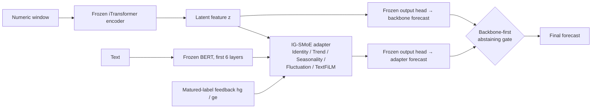

# On-Adapter

**Diagnosing, improving and confirming an online multimodal adapter on a unified nine-domain benchmark**

On-Adapter attaches a lightweight adapter to a frozen iTransformer backbone. The adapter fuses numeric and text information and keeps receiving feedback at test time from labels that arrive with a delay. This repository contains:

- a nine-domain multimodal time-series benchmark shared by all methods;
- a diagnosis of the original On-Adapter;
- the improved method, **On-Adapter-CV**;
- a confirmation experiment on 3 training seeds, run after the method was frozen.

> All results are **exploratory**; see [Limitations](#8-limitations). The full experimental design, statistical definitions and data sources are in [docs/EXPERIMENT_DESIGN_AND_RESULTS.md](docs/EXPERIMENT_DESIGN_AND_RESULTS.md).

---

## 1. Highlights

| | |
|---|---|
| **Best tail-risk rank** | Mean CVaR₉₀ rank 3.380, the best of 7 methods (static backbone: 3.843) |
| **Beats every other baseline** | Better main statistic than all online methods (ADAPT-Z, DSOF, Proceed) and multimodal methods (GPT4MTS, MM-TSFlib) |
| **Large gain over the original method** | Main statistic from 1.0936 to 1.0005; tasks with lower tail risk than the backbone from 17/36 to 22/36 |
| **Ties the static backbone, does not beat it** | Main statistic 0.05% above iTransformer; the remaining gap is concentrated in Health_US |

---

## 2. Results

**Confirmation setup:**
- training seeds 2025 / 2026 / 2027;
- the method and the plan were frozen before any confirmation result was produced; see [PLAN.json](results/confirmation/PLAN.json);
- no baseline was tuned.

| Method | Type | Main statistic S ↓ | Mean CVaR₉₀ rank ↓ | Mean MAE | Mean MSE | Tasks with lower tail than backbone |
|---|---|---:|---:|---:|---:|---:|
| iTransformer | static | **1.000000** | 3.843 | **1.0628** | **11.978** | — |
| **On-Adapter-CV (ours)** | online · multimodal | 1.000495 | **3.380** | 1.0716 | 12.100 | **22/36** |
| On-Adapter-TA (ablation: no CVaR loss) | online · multimodal | 1.000108 | 3.481 | 1.0655 | 12.008 | 21/36 |
| MM-TSFlib | static · multimodal | 1.014709 | 4.009 | 1.0690 | 12.089 | 16/36 |
| GPT4MTS | static · multimodal | 1.035984 | 4.000 | 1.0879 | 12.205 | 16/36 |
| ADAPT-Z | online | 1.049515 | 3.731 | 1.1421 | 13.390 | 18/36 |
| DSOF | online | 1.050956 | 3.972 | 1.2860 | 13.904 | 15/36 |
| On-Adapter (original) | online · multimodal | 1.093644 | — | 1.0974 | 12.210 | 17/36 |
| Proceed | online | 1.110804 | 5.065 | 1.1752 | 13.486 | 11/36 |

**Notes on the table:**
- **Main statistic S:** for each cell, take the ratio of its CVaR₉₀ to the CVaR₉₀ of iTransformer in the same cell; average over the 3 seeds; then take the equally weighted geometric mean over the 36 domain/H tasks. Lower is better; iTransformer is 1 by definition.
- **Mean rank:** the 7 methods are ranked within each of the 108 domain/H/seed cells and the ranks are averaged. The rank of On-Adapter-TA is computed in its own 7-method table.
- **Per-seed S:**
  - On-Adapter-CV: 1.00082 / 1.00118 / 0.99938;
  - On-Adapter-TA: 1.00192 / 0.99972 / 0.99857.

**Per-domain CVaR₉₀ relative to the backbone** (below 1 means better than iTransformer; averaged over the 3 seeds, then geometric mean over the 4 horizons):

| Domain | On-Adapter-CV | On-Adapter-TA | Share of origins using the adapter (CV / TA) |
|---|---:|---:|---:|
| Environment | **0.990** | 1.002 | 0.60 / 0.40 |
| Energy | 1.002 | 1.000 | 0.43 / 0.45 |
| Health_US | 1.029 | 1.018 | 0.46 / 0.39 |
| Traffic | **0.983** | **0.985** | 0.81 / 0.72 |
| SocialGood | 1.006 | 1.000 | 0.12 / 0.47 |
| Security | **0.999** | 1.000 | 0.23 / 0.35 |
| Economy | **0.998** | **0.999** | 0.54 / 0.52 |
| Climate | 1.003 | **0.999** | 0.25 / 0.34 |
| Agriculture | **0.995** | **0.998** | 0.58 / 0.56 |

Values are rounded to 3 decimals; per-task results are under `per_task` in [results.json](results/confirmation/results.json).

**Ablation:** the CVaR tail loss improves the mean rank (3.48 → 3.38) and the results on Environment, Agriculture and Traffic. It also worsens the tail on Health_US (1.018 → 1.029), so the main statistic does not go down. Both versions tie the backbone; neither strictly beats it.

---

## 3. Method: On-Adapter-CV



**Diagnosis of the original method** (details in [docs, section 5](docs/EXPERIMENT_DESIGN_AND_RESULTS.md#5-structure-and-diagnosis-of-the-original-on-adapter)):

| Problem | Evidence |
|---|---|
| Online parameter updates diverge on non-monthly domains | With updates off, the Energy CVaR ratio goes from about 1.96 back to about 1.00 |
| The VICReg alignment term dominates training | The training objective is 4–17 while the validation MSE is only 0.03–3 |
| Training budget too small | Only 3 epochs; with up to 15, some cells were still improving at epoch 15 |
| Training loss does not match the evaluation metric | Training uses element-wise MSE; evaluation looks at the tail of per-origin MAE |

**Five changes relative to the original method** (data, backbone, expert structure, text encoding and feedback computation are unchanged):

1. **Turn off the VICReg text–numeric alignment term** by setting its weight to 0.
2. **Raise the epoch cap from 3 to 15.** Early-stopping patience stays at 3, and the checkpoint is still chosen by validation MSE.
3. **CVaR₉₀ variational tail loss:** L = MSE + 0.5 · [τ + mean(max(eᵢ − τ, 0)) / 0.1].
   - eᵢ is the observed per-origin MAE, using the same variables, mask and scale as the scorer;
   - τ is an exponential moving average, across batches, of each batch's 90% quantile.
4. **Backbone-first abstaining gate:**
   - output the backbone forecast by default;
   - switch to the adapter when its discounted mean MAE (γ = 0.9) on matured origins is lower than the backbone's;
   - require at least 4 matured origins, with hysteresis.
5. **Turn off online parameter updates.** The hg/ge feedback and the gate decision still run at every origin; only the parameter update is skipped.

**Information boundary:** feedback and gating use only matured labels satisfying `old_origin + H ≤ current_origin`; a forecast never reads current or future targets or masks.

**Where the code is:**
- method package: [on_adapter/](on_adapter/), with the differences from the benchmark package recorded in `FORK.json`;
- gate: `abstain` in [confirmation/round5_gate.py](confirmation/round5_gate.py);
- online replay harness: [confirmation/harness.py](confirmation/harness.py).

---

## 4. Benchmark and evaluation protocol

### 4.1 Data

- **Source:** 9 domains of Time-MMD, with numeric series and the text `fact` field; one CSV per domain in [data/](data/) (`Health.csv` is Health_US).
- **Text:** the V1 minimal repair. It masks only entries verified against their sources as postdating the time they describe: 413 entries, 1.34%. Numeric columns are byte-identical.
- **Text encoding:** independent encoding; each text is passed forward on its own, with batch size always 1.

| Domain | Frequency | Lookback L | Horizons H |
|---|---|---:|---|
| Environment | daily | 96 | 48 / 96 / 192 / 336 |
| Energy, Health_US | weekly | 24 | 12 / 24 / 36 / 48 |
| Traffic, SocialGood, Security, Economy, Climate, Agriculture | monthly | 8 | 6 / 8 / 10 / 12 |

9 domains × 4 horizons = 36 tasks.

### 4.2 Protocol (identical for all methods)

- Chronological 60% / 20% / 20% train / validation / test split; standardization is fitted on the training segment only.
- Missing inputs are forward-filled from the past, then filled with the training mean. Missing targets are masked, never imputed.
- All methods share the same grid of forecast origins and the same masks.
- Checkpoints are selected by validation MSE; nothing is tuned on the test segment.

### 4.3 Scoring

Implemented as `cell_metrics` in [benchmark/score.py](benchmark/score.py):

1. For each forecast origin, take the MAE over all observed target elements, on the training-standardized scale.
2. CVaR₉₀ is the mean loss within the worst 10% of probability mass. The boundary origin enters with a fractional weight. The result is cross-checked against the variational definition, with error below 1e-12.
3. The main statistic S and the mean rank are aggregated from CVaR₉₀ as defined in section 2.

### 4.4 Baselines

| Method | Code source (pinned commit) | Source of results |
|---|---|---|
| iTransformer | thuml/Time-Series-Library `4e938a17` | Reused historical cells under the same protocol, verified by hash and numeric equivalence |
| ADAPT-Z | xiannanhuang/ADAPT-Z `f5b70e11` | Same as above |
| DSOF | yyalau/iclr2025_dsof `11cebd98` | Same as above |
| Proceed | SJTU-DMTai/OnlineTSF `0a864619` | Same as above |
| GPT4MTS | Flora-jia-jfr/GPT4MTS `c85e74b2` | Retrained on V1 |
| MM-TSFlib | AdityaLab/MM-TSFlib `e789ce78` | Retrained on V1 |
| On-Adapter (original) | Implementation from the original paper's supplement | Retrained on V1 |

**Result files:**
- V1 main table, 3 seeds × 36 tasks × 7 methods = 756 cells: [results.json](results/benchmark/results.json) and [results.csv](results/benchmark/results.csv);
- protocol: [PROTOCOL.md](results/benchmark/PROTOCOL.md).

---

## 5. Reproduction

### 5.1 Environment

Python 3.9, PyTorch 2.8 (CUDA 12.9). Run every command from the repository root.

```bash
pip install -r requirements.txt
bash third_party/fetch_code.sh      # download the 6 baselines' code at the commits in SOURCE.json and verify each file against MANIFEST.sha256
python third_party/fetch_weights.py # download the bert-base-uncased and gpt2 weights at pinned revisions
```

> **Paths must be replaced:** `runs_root`, `cache_root`, `control_file` and `report_root` in the config files, and `B=` in `confirmation/dispatch.sh`, are paths on the original experiment machine (`E:/FedNoise/...`, `C:/Users/.../iadapter-baselines`). Change them to local paths before use.

### 5.2 V1 benchmark main table

```bash
python -m benchmark.runner run      # train the 3 text-reading methods × 3 seeds; resumable
python -m benchmark.finalize audit
python -m benchmark.score
```

The 432 cells of the 4 methods that do not read text are reused from historical runs under the same protocol. Their hashes are pinned in [legacy_numeric_reuse_manifest.json](benchmark/legacy_numeric_reuse_manifest.json), and their compatibility is checked in two files: [reuse_verification.json](results/benchmark/reuse_verification.json) and [numeric_reuse_equivalence.json](results/benchmark/numeric_reuse_equivalence.json). Their original run directories are not in the repository.

### 5.3 On-Adapter-CV confirmation experiment

```bash
# 1) train (for On-Adapter-TA use configs/confirmation_ta.json)
python -m confirmation.runner run --config configs/confirmation_cv.json
# 2) per-origin online test trajectories
python confirmation/confirm.py --list cv | while read t d h s; do
  python confirmation/confirm.py --traj $t $d $h $s < /dev/null
done
# 3) score
python confirmation/confirm.py --score
```

`confirmation/dispatch.sh` chains the three steps: training runs serially on the GPU, and test trajectories run in parallel on the CPU.

---

## 6. Repository layout

```
├── data/                  V1 dataset: one CSV per domain (9 domains)
├── data_repair/           code and 348 decision rules that built the V1 text repair
├── methods/               implementations of the 7 methods (used in the main experiment)
├── on_adapter/            final method On-Adapter-CV / TA (a fork of methods/, see FORK.json)
├── on_adapter_original/   source of the original On-Adapter paper (experts, IG-SMoE adapter, VICReg alignment)
├── benchmark/             main experiment: scheduling, audit, frozen scoring (score.py), report
├── confirmation/          confirmation experiment: training (runner.py), online replay (harness.py),
│                          gate (round5_gate.py), trajectories and scoring (confirm.py), dispatch.sh
├── configs/               benchmark.json, confirmation_cv.json, confirmation_ta.json
├── results/
│   ├── data_repair/       report of the V1 text repair (coverage, token effects)
│   ├── benchmark/         7-method main table (756 cells), protocol, checks, frozen hashes
│   ├── development/       12 development rounds on seed 2: plans, selections, results
│   └── confirmation/      confirmation plan and results
├── third_party/           pinned sources of third-party code (code/) and weights (weights/),
│                          with download scripts fetch_code.sh and fetch_weights.py
├── docs/                  full design and results document
└── requirements.txt
```

`round1_calibration.py` and `round3_training.py` in `confirmation/` are helper modules carried over from development rounds 1 and 3; the confirmation scripts import them.

---

## 7. Development history

The method went through 12 rounds of iteration on a single training seed (seed 2), under these rules:
- each round froze its plan (`PLAN.json` and its sha256) first, and selection used the validation set only;
- the test set was computed only once per round;
- from round 8 on, the test set was used only if the robust validation score was ≤ 0.985.

| Round | Change | Test S | Outcome |
|---|---|---:|---|
| 1–2 | Online residual calibration (per step / per seasonal phase) | 1.015 / 1.013 | Validation–test reversal |
| 3 | VICReg off, epoch cap 15 | 1.006 | The adapter starts learning corrections |
| 4 | Gate + calibration experts | 1.009 | Calibration components fail |
| 5 | Backbone-first abstaining gate | 1.003 | Best main statistic on seed 2 |
| 6 | Small-step online updates | 1.003 | Tied with round 5 |
| 7–11 | Offline seasonal bias, ensemble, no auxiliary term, L2-SP anchoring | — | Rejected on validation; test not used |
| 12 | CVaR tail loss | 1.004 | Best mean rank of the 7 methods; became the final method |

Records:
- summaries: [SUMMARY_rounds1-8.md](results/development/SUMMARY_rounds1-8.md), [GOAL_STATUS.md](results/development/GOAL_STATUS.md);
- per-round details: `results/development/round*/`.

Only the code of the final pipeline is kept; intermediate method packages are not included.

---

## 8. Limitations

- **Same test period:** seeds 2025–2027 share the test period with development seed 2. The confirmation tests robustness to training randomness, not generalization to new data.
- **Unequal tuning effort:** On-Adapter went through 12 development rounds; every baseline uses its original settings.
- **Limited online component:** the final method turns off online parameter updates; its online part is only the feedback and the gate.
- **Backbone numeric difference:** On's internal backbone runs on the CPU; its maximum absolute difference from the main-table iTransformer (GPU) is 0.0101.
- **Text causality:** V1 only repairs confirmed timing mismatches; we cannot claim the text is entirely leak-free.
- **Scope of claims:** a 0.05% gap in the main statistic is statistically indistinguishable from a tie. This repository does not claim significance, universal superiority or SOTA.

---

## 9. Previous version

The previous repository contents (the code and data supplement of the original iAdapter paper) are kept under the tag [`legacy-iadapter-supplement`](https://github.com/lmh20050609-beep/on-adapter/tree/legacy-iadapter-supplement):

```bash
git checkout legacy-iadapter-supplement
```

The directory layout was simplified after the experiments (for example, `method_comparison_v1conf_20261009/` became `on_adapter/` and `reports/v1conf_20261009/` became `results/confirmation/`). Frozen records such as `PLAN.json`, `execution_lock.json`, `artifact_manifest.json` and the per-round development scripts keep the original paths, as they were recorded at the time. The renamed code was checked end to end: one confirmation cell rebuilt from `data/` with the new layout reproduces the saved forecasts bit for bit.

The documents, report generators and source comments in this repository were originally written in Chinese and have been translated into English. The Chinese originals are kept in the git history at commit `d1a8759`. Two consequences of the translation:

- the sha256 values recorded in `results/benchmark/artifact_manifest.json` for `REPORT.md`, `PROTOCOL.md` and `HANDOFF.md` refer to the Chinese originals;
- in `on_adapter_original/`, only comments, docstrings and messages were translated (the code is unchanged, checked by AST comparison), but the file hashes, and therefore the `source_fingerprint` recorded by the method packages, differ from those of the original runs.
